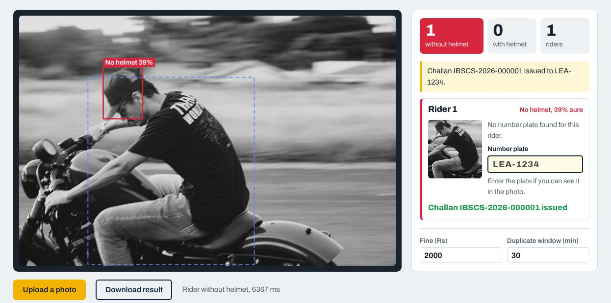

# Helmet Violation Detection

A traffic enforcement tool for motorcycle riders. Point a phone or webcam at the
road, or upload a photo, and a YOLOv8 model marks riders, heads with and without
helmets, and number plates.
Each rider without a helmet is matched to their number plate, the plate is read
with OCR, and an officer confirms a numbered challan. Everything runs in the
browser, so photos and challans never leave the device.

This is the reworked version of my final year project, the Integrated Bike
Safety and Challan System (IBSCS).

**Live demo:** https://mq-helmet-violation-detection.netlify.app/



## What it does

- Live camera mode: detection boxes drawn over the camera feed, with automatic capture of any frame that shows a rider without a helmet
- Photo mode: upload, drag and drop, paste, or try a sample photo
- Detects four classes: helmet, no helmet, rider and number plate
- Links every bare head to the rider box around it, and that rider to the plate inside or just below it
- Reads the plate with Tesseract OCR after cropping, enlarging and boosting contrast; the officer checks or types the plate
- Issues challans numbered `IBSCS-YYYY-000001`, with the fine amount and an evidence photo
- Refuses a second challan for the same plate inside a configurable duplicate window
- Keeps challan history in the browser, with CSV export
- Confidence slider and rider-box toggle that update without running the model again

## The model

| | |
|---|---|
| Architecture | YOLOv8l, 43.6M parameters |
| Classes | with helmet, without helmet, rider, number plate |
| Validation mAP50 | 0.947 |
| Validation mAP50-95 | 0.785 |
| Precision / recall | 0.941 / 0.918 |
| Input size | 640 x 640 |

The metrics are the ones recorded in the checkpoint at the end of training.
The training images are not part of this repository, so they cannot be
reproduced from it.

On general street photos, like the samples in the app, the model is less
reliable than those numbers suggest: small or distant riders are missed, and it
sometimes flags a pedestrian standing next to a bike. That is the reason every
challan needs an officer to confirm it instead of being issued automatically.

## How it runs in the browser

1. The photo is letterboxed to 640 x 640 the same way Ultralytics does it.
2. The model runs in a Web Worker with ONNX Runtime Web, so the page stays responsive. It uses the GPU through WebGPU where the browser supports it (recent Chrome and Edge), and falls back to WebAssembly on the CPU elsewhere. On the CPU a scan takes about 6 seconds on a laptop, so live mode is only smooth with WebGPU.
3. In live mode the worker takes one camera frame at a time; a new frame is sent only after the last result arrives, so a slow device never builds up a queue. When auto-capture is on, the first frame with a rider without a helmet is frozen and sent to the review panel.
4. The 8,400 candidate boxes are decoded and filtered with non-maximum suppression. Helmet and no-helmet share one group, so a head is never reported as both.
5. Plate crops go to Tesseract.js. Its worker, WebAssembly core and English model are copied from npm into the build, so nothing loads from a third-party CDN.

### Model size

The full-precision ONNX export is 175 MB. `training/export_onnx.py` stores the
large weight tensors as 16-bit floats and casts them back to 32-bit inside the
graph. The file is 87 MB and gives the same detections as full precision.
Dynamic int8 quantisation was tested too: it brought the file down to 44 MB but
moved "no helmet" confidences by up to 0.2, which changes who gets a challan,
so it was not used.

## Project structure

```
helmet-violation-detection/
├── models/helmet-yolov8l.pt      # trained PyTorch weights
├── training/export_onnx.py       # builds the 87 MB ONNX file for the web app
├── web/                          # Vite + React + TypeScript app (Node.js)
│   ├── src/detector/             # worker, letterbox, decoding, NMS, violation matching
│   ├── src/components/           # image stage, live camera, violation card, challan slip
│   ├── src/challans.ts           # numbering, duplicate check, CSV, storage
│   ├── src/ocr.ts                # plate crop, preprocessing, Tesseract
│   ├── scripts/copy-ocr.mjs      # copies the OCR files into the build
│   ├── public/models/            # helmet-yolov8l.onnx
│   ├── public/samples/           # sample road photos
│   └── tests/                    # Vitest unit tests
├── docs/images/
└── netlify.toml
```

## Run it

```bash
cd web
npm install
npm run dev      # local server
npm test         # decoding, NMS, violation matching and challan tests
npm run build    # production build in web/dist
```

To rebuild the ONNX file from the weights:

```bash
pip install -r training/requirements.txt
python training/export_onnx.py
```

## Limitations

- Trained on traffic-camera style images; it misses riders who are small in the frame and can flag pedestrians.
- Plate reading needs a sharp, roughly front-facing plate. Most plates in street photos are too small, so the officer types them in.
- Challans are stored in the browser's local storage, not in a shared database.
- The first visit downloads the 87 MB model; after that the browser cache is used.
- Without WebGPU, live mode scans about one frame every 6 seconds.

## Credits

Sample photos from Unsplash, free to use under the Unsplash License: Guilherme
Stecanella, Yunhao Luo, YearOne, Aldrin Rachman Pradana and Harry Feller.

## Tech stack

Python, Ultralytics YOLOv8, ONNX, ONNX Runtime Web (WebGPU and WebAssembly), Tesseract.js, MediaDevices camera API, TypeScript, React, Vite, Vitest, Node.js, Netlify
